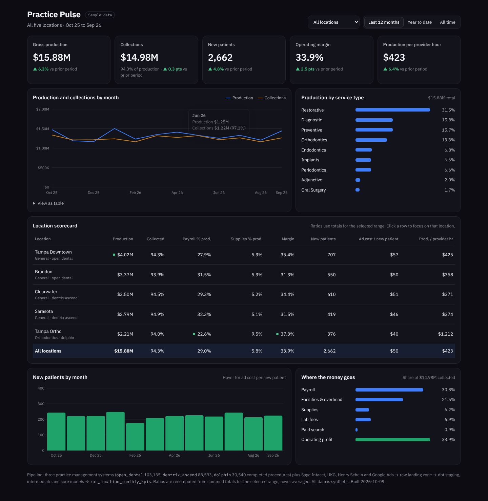

# Practice Pulse 2.0

**An end-to-end analytics pipeline for a multi-location dental group.** Raw exports from three different practice management systems and five back-office tools are loaded into a warehouse, cleaned and modeled with dbt, tested, and served as an executive KPI dashboard.



> All data in this repo is synthetic, generated to behave like the real thing. No patient or company data is included.

## The problem

A group of five dental offices runs three practice management systems (Open Dental, Dentrix Ascend and Dolphin for orthodontics), plus Sage Intacct for accounting, UKG for payroll, Henry Schein for supplies and Google Ads for marketing. Each system exports data in its own format, and none of them agree on how to name a location. Owners can't answer basic questions like "which office is most profitable?" without someone stitching spreadsheets together by hand every month.

Practice Pulse 2.0 puts all of it in one warehouse, defines every metric once, and checks the numbers automatically on every run.

## Architecture

```mermaid
flowchart LR
    subgraph Sources
        OD[Open Dental<br/>CSV, ISO dates]
        DX[Dentrix Ascend<br/>CSV, MM/DD/YYYY, $ strings]
        DO[Dolphin<br/>semicolon CSV, DD-MM-YYYY]
        SI[Sage Intacct GL]
        UK[UKG payroll]
        HS[Henry Schein orders]
        GA[Google Ads API<br/>JSON]
    end
    subgraph Warehouse["Warehouse (DuckDB locally, Snowflake in production)"]
        RAW[raw_* schemas<br/>text as exported + load metadata]
        STG[staging<br/>typed, cleaned, deduped, mapped]
        INT[intermediate<br/>3 PMS systems unioned]
        CORE[core<br/>star schema: dims + facts]
        RPT[reporting<br/>rpt_location_monthly_kpis]
    end
    Sources -->|Python loader| RAW --> STG --> INT --> CORE --> RPT
    RPT --> DASH[Executive dashboard]
```



| Layer | What happens there |
| --- | --- |
| **Raw** | `ingest/load_raw.py` lands every file untouched as text, plus `_source_file` and `_loaded_at`. The raw layer is always a faithful copy of what the vendor sent. |
| **Staging** | One model per source table. Parses three date formats, strips currency strings, maps every spelling of a location to a single `location_id`, and removes duplicate rows. |
| **Intermediate** | Unions completed production and payments from the three practice systems into one shape. Deleted and treatment-plan rows are excluded here. |
| **Core** | Star schema: `dim_locations`, `dim_date`, `dim_procedure_codes`, and fact tables for procedures, payments, payroll, operating expenses and marketing. |
| **Reporting** | `rpt_location_monthly_kpis`: one row per location per month with every KPI defined once. This is the only table the dashboard reads. |

## Real-world mess the pipeline handles

The sample data includes the problems real exports have, on purpose:

- **Three date formats** (`2026-09-30`, `09/30/2026`, `30-09-2026`) parsed with one cross-database macro
- **Currency strings** like `$1,234.56` cleaned to numbers
- **8 different spellings** of two office names (`CLEARWATER`, `Clearwater Office`, ` Sarasota`) mapped through a seed table, with a `not_null` test that fails loudly when a new spelling appears
- **897 duplicate rows** from Dentrix re-exports, removed with a window function
- **1,484 deleted procedures** still present in the Open Dental export, excluded from production
- **4,406 treatment-plan rows** that look like production but aren't
- **Refunds** recorded as negative payments
- **API data** that lands as raw JSON and gets flattened in staging

## Data quality

`dbt build` runs **23 models and 74 tests**. Beyond standard uniqueness, not-null, accepted-values and relationship tests, three custom tests protect the numbers that matter:

- **`assert_production_reconciles_to_sources`**: total production in the reporting table must match completed work in each source system to the cent. If a join drops or duplicates rows anywhere in the pipeline, this fails.
- **`assert_no_payments_before_service`**: a payment tied to a procedure can't predate it.
- **`assert_kpis_in_plausible_range`**: business guardrails on settled months (trailing 3-month collection ratio between 80% and 110%, payroll between 10% and 60% of production). Values outside those bands usually mean a broken load.

Sources also have freshness checks (`dbt source freshness`), so a stalled export shows up before the numbers go stale.

## KPI definitions

Every metric is defined once, in `rpt_location_monthly_kpis`, and documented in `_reporting.yml`.

| Metric | Definition |
| --- | --- |
| Gross production | Fees for completed procedures, before adjustments |
| Collections | Money received in the month, net of refunds |
| Collection ratio (T3M) | Trailing 3-month collections ÷ trailing 3-month production. Single months swing with payment lag, so this is the version to judge on. |
| New patients | Patients whose first completed procedure falls in the month |
| Production per provider hour | Production ÷ paid hours for dentists, orthodontists and hygienists |
| Payroll / supplies % of production | Cost ÷ gross production |
| Ad cost per new patient | Paid search spend ÷ new patients |
| Operating profit | Collections − payroll − supplies − lab fees − overhead − ad spend (a management estimate, not GAAP) |

The dashboard recomputes every ratio from summed totals for the selected range instead of averaging monthly ratios, which would weight a slow month the same as a busy one.

## Run it

Requires Python 3.10+.

```bash
git clone https://github.com/evannwilsonn/practice-pulse-2.0.git
cd practice-pulse-2.0
pip install -r requirements.txt
make all        # generate sources → load → dbt build → export dashboard data
make serve      # dashboard at http://localhost:8000
make docs       # dbt docs with the full lineage graph (target/static_index.html)
```

The whole pipeline runs in under a minute on a laptop.

## Running on Snowflake

Every model uses cross-database macros (`macros/cross_db.sql`) for date parsing, JSON access and the date spine, so the same SQL runs on DuckDB and Snowflake.

1. Load the raw files with `ingest/snowflake_load.sql` (stage, then `COPY INTO`).
2. `pip install dbt-snowflake`, then set `SNOWFLAKE_ACCOUNT`, `SNOWFLAKE_USER` and `SNOWFLAKE_PASSWORD`.
3. `dbt build --target snowflake`

## Project structure

```
ingest/            generate_sources.py, load_raw.py, snowflake_load.sql
seeds/             locations, location_aliases, procedure_codes
macros/            cross-database helpers, schema naming, unique_combination test
models/
  staging/         one model per source table, plus _sources.yml
  intermediate/    unioned procedures and payments, patient first visits
  marts/core/      star schema
  marts/reporting/ KPI table, procedure mix, dashboard exposure
tests/             reconciliation, payment timing, KPI guardrails
dashboard/         export_data.py, index.html
```

## Built with

Python · dbt · DuckDB · Snowflake-ready SQL · HTML/SVG dashboard

---

Built by [Evan Wilson](https://www.linkedin.com/in/evannwilsonn), founder of Wilstack Laboratories.
